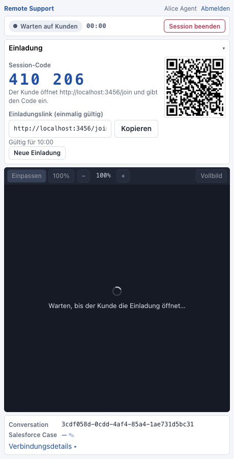
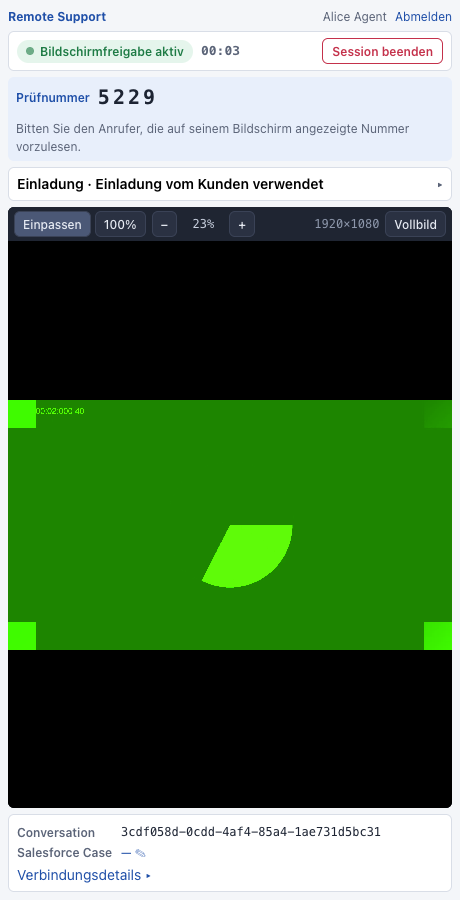
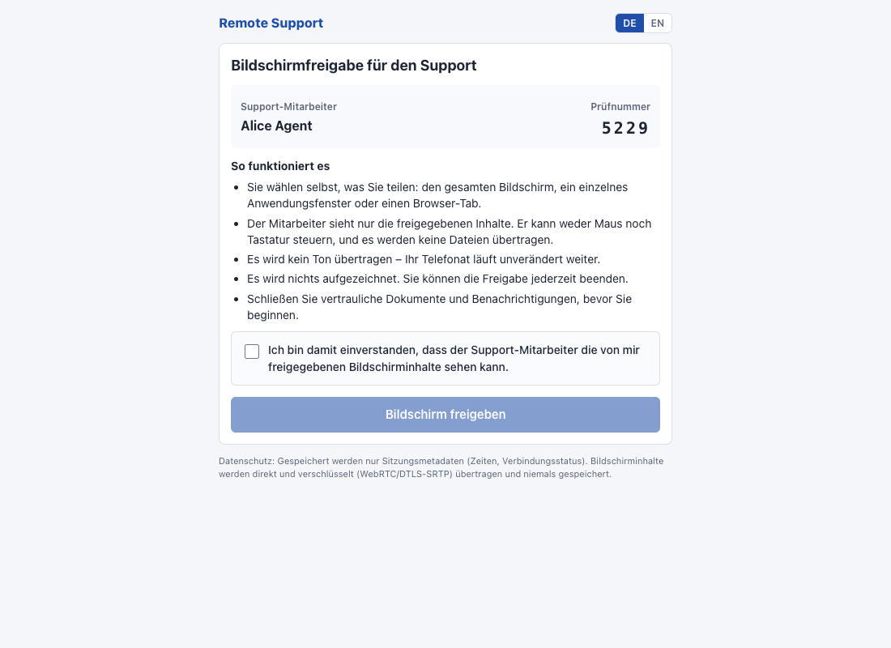
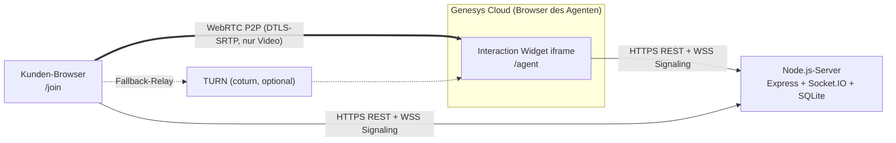

# Remote Support for Genesys Cloud

Proof of Concept für **vollständige Desktop-Bildschirmfreigabe** während eines laufenden Genesys-Cloud-Telefonats:
Der Kunde gibt im Browser – ohne Installation und ohne Administratorrechte – seinen gesamten Bildschirm frei,
der Agent sieht ihn live in einem **Interaction Widget** direkt in Genesys Cloud. Der Anruf selbst bleibt unberührt.

| Agent (Interaction Widget, Einladung) | Agent (Freigabe aktiv) | Kunde (Zustimmung) |
| --- | --- | --- |
|  |  |  |

*(Screenshots aus dem automatisierten Browser-Test; das grüne Bild ist Chromes simulierter Testbildschirm.)*

**Inhalt**

- [Funktionsumfang](#funktionsumfang)
- [Architektur](#architektur)
- [1. Lokaler Start (macOS und Windows)](#1-lokaler-start-macos-und-windows)
- [2. Test ohne Genesys Cloud](#2-test-ohne-genesys-cloud)
- [3. Deployment auf Render](#3-deployment-auf-render)
- [4. TURN-Setup](#4-turn-setup)
- [5. Interaction Widget in Genesys Cloud einrichten](#5-interaction-widget-in-genesys-cloud-einrichten)
- [6. Exakte Application URL](#6-exakte-application-url)
- [7. Iframe-Sandbox und Permissions Policy](#7-iframe-sandbox-und-permissions-policy)
- [8. Offizielle Genesys-Gruppe für Testbenutzer](#8-offizielle-genesys-gruppe-für-testbenutzer)
- [9. Einschränkung auf Voice und ausgewählte Queues](#9-einschränkung-auf-voice-und-ausgewählte-queues)
- [10. Test während eines echten Anrufs](#10-test-während-eines-echten-anrufs)
- [11. Troubleshooting](#11-troubleshooting)
- [12. Sovereign Cloud und Sonderregionen](#12-sovereign-cloud-und-sonderregionen)
- [13. Deaktivierung und vollständige Entfernung](#13-deaktivierung-und-vollständige-entfernung)
- [Sicherheitskonzept](#sicherheitskonzept)
- [Datenmodell, Salesforce-Vorbereitung und Webhook](#datenmodell-salesforce-vorbereitung-und-webhook)
- [Tests und Testmatrix](#tests-und-testmatrix)
- [Bekannte Grenzen des PoC](#bekannte-grenzen-des-poc)

---

## Funktionsumfang

**Agent (`/agent`, läuft als Interaction Widget im Genesys-Iframe)**

- Liest `conversationId`, `gcHostOrigin`, `gcTargetEnv`, `language` aus der Widget-URL. Jede Session wird automatisch mit der Genesys Conversation ID verknüpft.
- Eigene PoC-Anmeldung je Agent (individuelle Testkonten, serverseitig geprüfte Tokens). URL-Parameter und Conversation IDs sind **kein** Berechtigungsnachweis.
- „Remote Support starten“ erzeugt einen **einmaligen Einladungslink**, einen **6-stelligen Session-Code** und einen QR-Code. Beides ist 10 Minuten gültig und nur einmal nutzbar.
- Kopieren-Button mit Fallback für Iframes ohne Clipboard-Berechtigung.
- Statusanzeige: *Warten auf Kunden → Kunde verbunden → Warten auf Bildschirmfreigabe → Bildschirmfreigabe aktiv*. Dazu *Verbindung unterbrochen*, *Bildschirmfreigabe beendet* und *Session beendet*.
- 4-stellige **Prüfnummer**, die Agent und Kunde gleichzeitig sehen. Der Agent lässt sie sich am Telefon vorlesen und erkennt so, dass der richtige Anrufer verbunden ist.
- Live-Video mit **Einpassen**, **100 %**, Zoom ±, Strg/⌘+Mausrad, Verschieben per Maus, optional Vollbild.
- Session-Dauer, „Session beenden“ (mit Bestätigung) und optionale Salesforce Case ID (nachträglich editierbar).
- „Verbindungsdetails“: ICE-, Signaling- und Peer-Status, Kandidatentyp (host/srflx/relay), Auflösung, FPS, Bitrate, Paketverlust, RTT und Qualitätsbewertung.
- Wird das Widget neu geladen oder wechselt der Agent zwischen Interaktionen, nimmt es die offene Session dieser Conversation automatisch wieder auf.

**Kunde (`/join`)**

- Öffnet den Einladungslink oder gibt den Code unter `https://IHRE-DOMAIN/join` ein.
- Sieht Erklärung, Agentenname und Prüfnummer und muss **ausdrücklich zustimmen**. Erst dann ist „Bildschirm freigeben“ aktiv.
- `getDisplayMedia()` wird unmittelbar im Klick aufgerufen. Der Kunde wählt selbst Bildschirm, Fenster oder Tab.
- Nur Video, kein Mikrofon und kein Systemton. Maximal 1920×1080 bei 15 fps, adaptive Bitrate (Standard max. 2,5 Mbit/s), Optimierung auf Textschärfe.
- Dauerhaft sichtbarer Freigabehinweis und „Freigabe beenden“. Auch das Beenden über die Browserleiste wird erkannt.
- Deutsch und Englisch (automatisch nach Browser oder Einladung, umschaltbar).

**Nicht enthalten (bewusst):** Fernsteuerung, Maus- und Tastatureingaben, Clipboard-Sharing, Dateiübertragung, Audio und serverseitige Aufzeichnung.

## Architektur



- **Ein Server, eine Domain:** Frontend (React/Vite-Build), REST-API (`/api/*`) und Signaling (`/socket.io`) laufen auf demselben Origin. Dadurch gibt es kein CORS und keine Cookies (Agent-Token im `sessionStorage`).
- **Medien gehen nie über den Server.** Der Server vermittelt nur SDP und ICE (Signaling) und speichert Metadaten.
- **WebRTC:** Der Kunde ist immer der Offerer (sendonly). Dazu kommen Trickle ICE mit Candidate-Queue und Verbindungs-IDs (`pcId`) gegen veraltete Signale sowie ICE-Restart bei Unterbrechung. Fällt die Verbindung ganz aus, wird sie neu aufgebaut.
- **Code-Struktur**

  | Pfad | Inhalt |
  | --- | --- |
  | `server/src/` | Konfiguration, Auth, Sessions, Signaling, Security, Integrationen |
  | `client/src/` | Seiten, Komponenten, WebRTC-Logik, i18n |
  | `shared/protocol.ts` | gemeinsame Typen und Events |
  | `tests/` | Unit- und Integrationstests (Vitest) |
  | `e2e/` | Browser-Tests (Playwright) |
  | `deploy/` | coturn- und Caddy-Konfiguration |

---

## 1. Lokaler Start (macOS und Windows)

**Voraussetzung:** Node.js **24 LTS** (mindestens 22.13). Die Anwendung nutzt das eingebaute `node:sqlite`, daher wird kein nativer Build und kein Visual Studio benötigt.

### macOS

```bash
# Node 24 installieren, z. B. mit Homebrew oder von https://nodejs.org
brew install node@24
cd "GC ScreenShare"
npm install
cp .env.example .env          # optional, alle Werte haben Entwicklungs-Defaults
npm run dev
```

### Windows (PowerShell)

```powershell
# Node 24 LTS installieren, z. B.:
winget install OpenJS.NodeJS.LTS
cd "GC ScreenShare"
npm install
Copy-Item .env.example .env   # optional
npm run dev
```

Danach `http://localhost:3000` öffnen. `npm run dev` startet den Server mit Vite-Hot-Reload.
Ohne `AGENT_ACCOUNTS` wird automatisch ein Entwicklungskonto **`demo`** angelegt. Das Passwort steht in der Konsole (`dev_agent_account_created`). Ein festes Passwort setzen Sie mit `DEV_AGENT_PASSWORD=...` in `.env`.

### Agent-Konten anlegen (`AGENT_ACCOUNTS`)

`AGENT_ACCOUNTS` ist die Liste der Agenten, die sich im Widget anmelden dürfen. In Produktion (z. B. auf Render) startet die Anwendung ohne diese Variable nicht. Die Konten sind bewusst unabhängig von Genesys-Benutzern; der Benutzername darf aber gleich lauten.

**Schritt 1 – pro Agent einen Eintrag erzeugen** (lokal im Projektordner):

```bash
npm run agent:create -- anna "Anna Agent"
```

- `anna` ist der Benutzername für den Login (2–64 Zeichen: Buchstaben, Ziffern, `.` `_` `@` `-`).
- `"Anna Agent"` ist der Name, den Agent und Kunde angezeigt bekommen.
- Das Skript fragt zweimal verdeckt nach einem Passwort (mindestens 10 Zeichen).

Ausgegeben wird **eine Zeile**: Benutzername, Anzeigename und ein Hash des Passworts, getrennt durch `|`. Das Passwort selbst wird nirgends gespeichert.

```text
anna|Anna Agent|scrypt:16384:8:1:Xy3kQ...:9fQ2a...
```

**Schritt 2 – die Zeile als Wert von `AGENT_ACCOUNTS` eintragen**

- Lokal in `.env`: `AGENT_ACCOUNTS=anna|Anna Agent|scrypt:16384:8:1:Xy3kQ...:9fQ2a...`
- Auf Render: *Environment → AGENT_ACCOUNTS* → die Zeile als Wert einfügen → *Save Changes* (Render startet neu).

**Schritt 3 – mehrere Agenten:** Das Skript pro Agent ausführen und die Zeilen mit einem **Semikolon `;`** hintereinander setzen:

```text
AGENT_ACCOUNTS=anna|Anna Agent|scrypt:...;ben|Ben Agent|scrypt:...
```

**Anmelden:** Im Widget bzw. auf `/demo` gibt Anna den Benutzernamen `anna` und ihr gewähltes Passwort ein.
**Passwort ändern oder Agent entfernen:** neue Zeile erzeugen bzw. Zeile löschen, `AGENT_ACCOUNTS` aktualisieren, neu starten.

**Produktionsbuild lokal:**

```bash
npm run build
npm start                     # nutzt dist/, NODE_ENV aus .env (Standard: development)
```

**Nützliche Skripte**

| Skript | Zweck |
| --- | --- |
| `npm run dev` | Entwicklung mit Hot Reload |
| `npm run build` / `npm start` | Build und Start |
| `npm run typecheck` | TypeScript-Prüfung aller Teile |
| `npm test` | Unit- und Integrationstests |
| `npm run test:e2e` | Browser-Tests |
| `npm run test:all` | alles zusammen |
| `npm run agent:create` | Agent-Konto erzeugen |
| `npm run secret:generate` | zufälliges `SERVER_SECRET` |

## 2. Test ohne Genesys Cloud

Die Seite **`/demo`** (abschaltbar mit `DEMO_ENABLED=false`) simuliert das Interaction Widget.

1. `http://localhost:3000/demo` öffnen und mit einem Agent-Konto anmelden.
2. **„Agent-Session starten“**: Es wird eine zufällige Test-Conversation-ID erzeugt und eine Agent-Session gestartet (gleiche Komponente wie im Widget). Für **parallele Sessions** mehrfach klicken; jede Session hat ihre eigene Einladung und ihr eigenes Video.
3. **Kundenseite im zweiten Browser öffnen:** Einladungslink kopieren oder `http://localhost:3000/join` öffnen und den Code eingeben. Verwenden Sie einen anderen Browser oder ein privates Fenster, damit getrennte Speicherbereiche gelten.
4. Prüfnummer vergleichen, zustimmen, „Bildschirm freigeben“ und „Gesamter Bildschirm“ wählen.
5. Im Agent-Panel erscheint das Live-Bild. Unter „Verbindungsdetails“ sehen Sie ICE-Route, Auflösung und FPS.
6. Optional **„Als eingebettetes Widget testen (iframe)“**: lädt `/agent` in einem Sandbox-Iframe mit den von Genesys Cloud angebotenen Sandbox-Optionen.
7. Die Tabelle „Letzte Sessions“ zeigt alle Sessions des angemeldeten Agenten mit gespeicherten Metadaten und Audit-Log.

**Test mit zwei Rechnern:** Bildschirmfreigabe funktioniert nur in einem *sicheren Kontext*. `http://localhost` zählt dazu, eine LAN-IP wie `http://192.168.x.x` nicht.
Für einen zweiten Rechner gibt es drei Wege:

- **Render** (Kapitel 3), der einfachste Weg.
- **Lokales HTTPS**, z. B. mit [mkcert](https://github.com/FiloSottile/mkcert): `HTTPS_CERT_FILE` und `HTTPS_KEY_FILE` setzen und das Zertifikat auf dem zweiten Rechner vertrauen.
- **HTTPS-Tunnel**, z. B. `cloudflared tunnel --url http://localhost:3000`, mit `PUBLIC_BASE_URL=<Tunnel-URL>`.

## 3. Deployment auf Render

Render unterstützt WebSockets und terminiert TLS. Die Anwendung erkennt `RENDER_EXTERNAL_URL` automatisch.

### Variante A: Blueprint (empfohlen)

1. Repository zu GitHub oder GitLab pushen.
2. In Render: **New → Blueprint** → Repository wählen. `render.yaml` legt den Web Service **gc-remote-support** an:
   - Node 24
   - Build: `npm ci --include=dev && npm run build`
   - Start: `npm start`
   - Health-Check `/api/health`
   - Disk unter `/var/data`
   - Region Frankfurt
3. Render fragt die geheimen Werte ab:

   | Variable | Wert |
   | --- | --- |
   | `AGENT_ACCOUNTS` | **Pflicht.** Die Login-Konten der Agenten, siehe [Agent-Konten anlegen](#agent-konten-anlegen-agent_accounts) |
   | `PUBLIC_BASE_URL` | leer lassen (dann `https://<name>.onrender.com`) oder eigene Domain, z. B. `https://support.example.com` |
   | `GC_ALLOWED_HOST_ORIGINS` | leer = alle öffentlichen Genesys-Regionen. Empfohlen: nur Ihre Region, z. B. `https://apps.mypurecloud.de` |
   | `FRAME_ANCESTORS_EXTRA` | leer (später z. B. Salesforce) |
   | `TURN_URLS`, `TURN_SECRET` | siehe Kapitel 4 (zunächst leer möglich) |
   | `SESSION_END_WEBHOOK_URL`, `SESSION_END_WEBHOOK_SECRET` | optional |

   `SERVER_SECRET` erzeugt Render automatisch (`generateValue`).
4. **Apply.** Nach dem Deploy prüfen:
   - `https://<name>.onrender.com/api/health` liefert `{"ok":true}`.
   - `/demo` öffnen und Kapitel 2 mit zwei Rechnern durchspielen.

### Variante B: manuell

- **New → Web Service**, Runtime **Node**
- Build Command `npm ci --include=dev && npm run build`, Start Command `npm start`, Health Check Path `/api/health`
- Unter *Disks* eine Disk mit Mount Path `/var/data` anlegen
- Umgebungsvariablen:
  - `NODE_ENV=production`
  - `NODE_VERSION=24`
  - `SERVER_SECRET` (Ausgabe von `npm run secret:generate`)
  - `AGENT_ACCOUNTS`
  - `DATABASE_PATH=/var/data/remote-support.sqlite`
  - `TRUST_PROXY=1`
  - `CLIENT_IP_HEADER=cf-connecting-ip`

**Hinweise**

- **Genau eine Instanz.** Live-Status und Socket.IO-Räume liegen im Speicher, daher ist keine horizontale Skalierung möglich.
- Der **Free-Plan** hat keine Disk und schläft nach Inaktivität ein. Er reicht nur für kurze Tests: `disk` entfernen und `DATABASE_PATH=/tmp/remote-support.sqlite` setzen; die Metadaten gehen bei jedem Neustart verloren.
- **Eigene Domain:** In Render unter *Settings → Custom Domains* hinzufügen, danach `PUBLIC_BASE_URL` setzen. Die Interaction-Widget-URL muss genau diese Domain verwenden.
- `CLIENT_IP_HEADER=cf-connecting-ip` sorgt dafür, dass die Rate Limits die echte Client-IP verwenden. Render leitet allen Verkehr über Cloudflare.
- Alternativ als Docker-Image deploybar (`Dockerfile`). Für eigene Server enthält `docker-compose.yml` die optionalen Profile `https` (Caddy mit automatischem Let's Encrypt) und `turn` (coturn):

  ```bash
  docker compose --profile https --profile turn up -d --build
  ```

  Variablen dafür siehe `.env.example`, Abschnitt „docker compose only“.

## 4. TURN-Setup

Ohne TURN funktionieren direkte Verbindungen (host) und NAT-Traversal per STUN (srflx). Hinter symmetrischem NAT, Firmen-Firewalls oder Proxys braucht es einen **TURN-Relay**. Render kann keinen TURN-Server betreiben (kein UDP), daher läuft TURN auf einer eigenen kleinen VM mit öffentlicher IP.

### coturn auf einer Linux-VM (Docker)

1. VM mit öffentlicher IPv4 anlegen, DNS-Eintrag `turn.example.com` setzen.
2. Firewall öffnen:
   - `3478/udp` und `3478/tcp`
   - `5349/tcp` (TLS)
   - Relay-Bereich `49160-49200/udp` (≈ 2 Ports je aktive Session, in `deploy/coturn/turnserver.conf` anpassbar)
3. Repository auf die VM kopieren und `.env` anlegen:

   ```env
   TURN_SECRET=<npm run secret:generate>
   TURN_REALM=turn.example.com
   TURN_EXTERNAL_IP=<öffentliche IPv4 der VM>
   ```

4. `docker compose --profile turn up -d coturn`
5. Für `turns:` (TLS) Zertifikate einbinden: `cert` und `pkey` in `deploy/coturn/turnserver.conf` aktivieren und die Zertifikatsdateien mounten. In Firmennetzen, die nur 443/TLS erlauben, coturn auf einer eigenen IP mit `tls-listening-port=443` betreiben.

Ohne Docker: `apt install coturn`, `deploy/coturn/turnserver.conf` nach `/etc/turnserver.conf` kopieren und dort ergänzen:

```conf
static-auth-secret=...
realm=...
external-ip=...
```

### Anwendung konfigurieren (Render-Umgebungsvariablen)

```env
TURN_URLS=turn:turn.example.com:3478?transport=udp,turn:turn.example.com:3478?transport=tcp,turns:turn.example.com:5349?transport=tcp
TURN_SECRET=<derselbe Wert wie bei coturn>
```

- Die Anwendung erzeugt pro Session **kurzlebige TURN-Zugangsdaten** nach dem TURN-REST-Verfahren (`use-auth-secret` bei coturn, Standard-Gültigkeit 4 h). Das Secret verlässt den Server nie.
- Alternativ statische Zugangsdaten mit `TURN_USERNAME` und `TURN_PASSWORD`, z. B. bei einem gehosteten TURN-Dienst.
- **TURN-only-Modus** für alle Sessions: `ICE_TRANSPORT_POLICY=relay`. Pro Session lässt er sich auch im Agent-Widget erzwingen („TURN-Relay erzwingen“).
- **Prüfen:** Session mit „TURN-Relay erzwingen“ starten. Unter „Verbindungsdetails“ muss die Route `relay / relay` lauten.
- `deploy/coturn/turnserver.conf` verbietet Relays in private Netze (`denied-peer-ip`), damit der TURN-Server nicht als Proxy ins Hosting-Netz missbraucht werden kann.

## 5. Interaction Widget in Genesys Cloud einrichten

Grundlage: [Set up an Interaction Widget integration](https://help.genesys.cloud/articles/set-up-an-interaction-widget-integration/) und [Client Apps](https://developer.genesys.cloud/platform/integrations/client-apps/).

**Voraussetzungen**

- Genesys Cloud CX 1 oder höher.
- Berechtigungen *Integrations > Integration > All* (in *Master Admin* enthalten).
- Die Anwendung ist per HTTPS erreichbar (Kapitel 3).

**Einrichtung**

1. **Admin → Integrations → Integrations** öffnen (bzw. **Menu → IT and Integrations → Integrations**).
2. **Add Integration** (bzw. „+ Integrations“) klicken, nach **Interaction Widget** suchen und **Install** wählen.
3. Im Reiter **Details** den Namen setzen, z. B. `Remote Support`.
4. Reiter **Configuration → Properties** ausfüllen:

   | Feld | Wert |
   | --- | --- |
   | Application URL | siehe [Kapitel 6](#6-exakte-application-url) |
   | Iframe Sandbox Options | `allow-forms,allow-modals,allow-popups,allow-same-origin,allow-scripts` ([Kapitel 7](#7-iframe-sandbox-und-permissions-policy)) |
   | Iframe Feature/Permissions Policy | `clipboard-write,fullscreen` |
   | Group Filtering | offizielle Testgruppe ([Kapitel 8](#8-offizielle-genesys-gruppe-für-testbenutzer)) |
   | Queue Filtering | gewünschte Queues ([Kapitel 9](#9-einschränkung-auf-voice-und-ausgewählte-queues)) |
   | Communication Type Filtering | `call` |

5. Optional unter **Configuration → Advanced** ein Icon hinterlegen (JSON mit `icon.vector` als URL, z. B. `https://IHRE-DOMAIN/favicon.svg`).
6. **Save.**
7. Reiter **Details**: Schalter **Inactive → Active** und mit **Yes** bestätigen.
8. Die Agenten laden Genesys Cloud neu. In einer passenden Interaktion erscheint rechts neben der Interaktionsleiste ein Tab „Remote Support“.

**Anmeldung im Widget:** Beim ersten Öffnen meldet sich der Agent mit seinem PoC-Konto an. Das Token gilt pro Genesys-Browser-Tab (Standard 10 h, `AGENT_TOKEN_TTL_HOURS`), es werden keine Cookies verwendet.
Genesys startet je Interaktion eine eigene Widget-Instanz (maximal 10 gleichzeitig). Die Sessions sind pro Conversation getrennt.

## 6. Exakte Application URL

```
https://YOUR-DOMAIN/agent?conversationId={{gcConversationId}}&gcHostOrigin={{gcHostOrigin}}&gcTargetEnv={{gcTargetEnv}}&language={{gcLangTag}}
```

`YOUR-DOMAIN` ersetzen Sie durch die Domain aus `PUBLIC_BASE_URL`, z. B. `gc-remote-support.onrender.com`. Die geschweiften Klammern bleiben stehen: Genesys ersetzt die Tokens beim Laden, z. B.

```
https://gc-remote-support.onrender.com/agent?conversationId=85ff71c0-f96d-45f6-9d98-fa5e01b22af8&gcHostOrigin=https%3A%2F%2Fapps.mypurecloud.de&gcTargetEnv=prod-euc1&language=de-de
```

So prüft die Anwendung die Parameter:

| Parameter | Prüfung |
| --- | --- |
| `conversationId` | muss eine UUID sein |
| `gcHostOrigin` | muss auf der Allowlist stehen (`GC_ALLOWED_HOST_ORIGINS` bzw. öffentliche Regionen) |
| `gcTargetEnv` | wird syntaktisch geprüft |

Nicht ersetzte Tokens (`{{...}}`) und ungültige Werte zeigt das Widget als Fehler an. Die veralteten Tokens `pcConversationId` und `pcLangTag` werden ebenfalls akzeptiert.
Diese Werte dienen **nur der Zuordnung**, nicht der Authentifizierung.

## 7. Iframe-Sandbox und Permissions Policy

**Iframe Sandbox Options** (kommagetrennt, ohne Leerzeichen):

| Option | Nötig? | Grund |
| --- | --- | --- |
| `allow-scripts` | **ja** | React-Anwendung, WebRTC |
| `allow-same-origin` | **ja** | eigener Origin für API und WebSocket; `sessionStorage` für das Agent-Token |
| `allow-forms` | **ja** | Login-Formular (ohne diese Option blockiert der Browser das Absenden) |
| `allow-popups` | empfohlen | Links in neuem Tab öffnen (z. B. Einladungslink testen) |
| `allow-modals` | optional | nicht zwingend; die Anwendung nutzt eigene Bestätigungen statt Browserdialogen |
| `allow-presentation`, `allow-downloads` | nein | werden nicht verwendet |

**Iframe Feature/Permissions Policy:** `clipboard-write,fullscreen`

- Ohne `clipboard-write` zeigt der Kopieren-Button einen markierten Text zum manuellen Kopieren (Strg/⌘+C).
- Ohne `fullscreen` wird das Video innerhalb des Widgets maximiert statt echtem Vollbild.
- `display-capture`, `camera` und `microphone` braucht der Agent **nicht**: Er empfängt nur, er sendet nichts.

Die Anwendung setzt für `/agent` serverseitig `Content-Security-Policy: frame-ancestors 'self' <Genesys-Allowlist>` und **kein** `X-Frame-Options`. `/join` darf überhaupt nicht eingebettet werden (`frame-ancestors 'none'`, `X-Frame-Options: DENY`).

## 8. Offizielle Genesys-Gruppe für Testbenutzer

Interaction Widgets sind nur für Mitglieder einer **offiziellen Gruppe** sichtbar. Verteilergruppen (Distribution Groups) funktionieren nicht.

1. **Admin → Directory → Groups → Add Group** (bzw. **Menu → Directory → Groups**).
2. Name, z. B. `Remote Support PoC`, und **Type: Official**. Die Sichtbarkeit nach Bedarf setzen.
3. Unter **Members** die Testagenten hinzufügen. Ein Administrator muss die Gruppe als offiziell anlegen.
4. In der Integration (Kapitel 5) unter **Group Filtering → Select Groups** genau diese Gruppe wählen und speichern.
5. Für jeden Testagenten mit `npm run agent:create` ein PoC-Konto anlegen und in `AGENT_ACCOUNTS` eintragen. Als Agent-ID eignet sich z. B. der Genesys-Benutzername.

## 9. Einschränkung auf Voice und ausgewählte Queues

- **Communication Type Filtering:** `call`. Damit erscheint das Widget nur bei Sprach-Interaktionen, nicht bei Chat, Messaging oder E-Mail. Die Medientypen sind in den [Available media types](https://developer.genesys.cloud/routing/routing/available-media-types) beschrieben.
- **Queue Filtering → Select Queues:** nur die Queues der Testgruppe wählen. Leer bedeutet keine Queue-Einschränkung.
- Gruppen-, Queue- und Typfilter wirken zusammen: Das Widget erscheint nur, wenn **alle** zutreffen.
- **Zusätzliche serverseitige Absicherung (optional):** Wird die Platform API aktiviert, prüft der Server beim Start einer Session lesend, ob die Conversation in der Org existiert und noch läuft. Der Rest der Anwendung funktioniert auch ohne diese Prüfung.

  ```env
  GENESYS_API_ENABLED=true
  GENESYS_API_REGION=mypurecloud.de
  GENESYS_CLIENT_ID=...
  GENESYS_CLIENT_SECRET=...
  GENESYS_VERIFY_CONVERSATION=true
  ```

  - **OAuth-Client:** *Admin → OAuth → Add Client*, Grant Type **Client Credentials**.
  - **Rolle:** nur *Conversation > Communication > View* für die Divisionen der Queues.
  - **Nur lesend:** Es wird ausschließlich `GET /api/v2/conversations/{id}` aufgerufen. Conversations und Routing werden nie verändert.

## 10. Test während eines echten Anrufs

**Voraussetzungen**

- Integration aktiv (Kapitel 5).
- Der Testagent ist in der offiziellen Gruppe, **On Queue** in einer gefilterten Queue und hat ein PoC-Konto.
- Ein zweiter Rechner (Windows oder macOS) für den „Kunden“, idealerweise in einem anderen Netz (z. B. Mobilfunk-Hotspot).

**Ablauf**

1. Testanruf von einem Telefon auf die Nummer bzw. den Flow der Queue starten und als Agent annehmen.
2. Im Interaktionsbereich auf den Tab **Remote Support** klicken und beim ersten Mal anmelden.
3. Optional die Salesforce Case ID eintragen und **Remote Support starten** klicken.
4. Dem Anrufer am Telefon diktieren: „Öffnen Sie **IHRE-DOMAIN/join** und geben Sie den Code **123 456** ein.“ Alternativ den Link über einen vorhandenen Kanal schicken; die Anwendung versendet selbst nichts.
5. Der Kunde liest die **Prüfnummer** vor. Der Agent vergleicht sie mit seiner Anzeige.
6. Der Kunde stimmt zu, klickt **Bildschirm freigeben** und wählt **Gesamter Bildschirm**. Unter macOS ist dafür die Bildschirmaufnahme-Berechtigung des Browsers nötig (Kapitel 11).
7. Der Agent sieht den vollständigen Desktop. Der Kunde öffnet zum Test eine lokale Anwendung (z. B. Windows-Explorer, Rechner, Office).

**Prüfpunkte**

- Gesprächsaudio, Halten, Stummschalten, Weiterleiten und Auflegen funktionieren unverändert.
- Freigabe stoppen und wieder starten (Kunden-Button und Browserleiste).
- Widget neu laden: Die Session wird wieder aufgenommen.
- Zweiter Agent mit eigenem Anruf parallel: Die Sessions sind getrennt.
- **Session beenden.** Danach in `/demo` (Tabelle „Letzte Sessions“) oder über `GET /api/sessions?conversationId=<id>` prüfen, ob die gespeicherte Conversation ID der Interaktion entspricht. Die Conversation ID ist in Genesys unter *Interaction Details* sichtbar.

## 11. Troubleshooting

| Symptom | Ursache und Lösung |
| --- | --- |
| Widget-Tab erscheint nicht | Integration **Active**? Agent in der **offiziellen** Gruppe? Queue- und Typ-Filter passend (`call`)? Genesys neu laden. Zum Eingrenzen Queue- und Typfilter vorübergehend leeren. |
| Widget bleibt leer oder „refused to connect“ | CSP `frame-ancestors` lässt den Genesys-Origin nicht zu. In der Browser-Konsole (F12) nach `frame-ancestors` suchen und den gemeldeten Origin in `GC_ALLOWED_HOST_ORIGINS` aufnehmen (Kapitel 12). Ein vorgeschalteter Proxy darf kein `X-Frame-Options` hinzufügen. |
| „Ungültige Widget-URL-Parameter“ | Application URL falsch geschrieben (Kapitel 6). Nicht ersetzte Tokens `{{...}}` bedeuten Tippfehler im Tokennamen. |
| `gc_host_origin_not_allowed` | `gcHostOrigin` nicht auf der Allowlist. `GC_ALLOWED_HOST_ORIGINS` ergänzen. |
| Login im Widget reagiert nicht | `allow-forms` fehlt in den Sandbox-Optionen. |
| Kopieren funktioniert nicht | `clipboard-write` in der Permissions Policy ergänzen. Bis dahin wird der Text zum manuellen Kopieren markiert. |
| Status „Verbindung zum Server wird wiederhergestellt…“ | WebSocket blockiert. `wss://IHRE-DOMAIN/socket.io/` muss erreichbar sein; die Anwendung fällt sonst auf HTTP-Long-Polling zurück. Proxy und Firewall auf WebSocket-Upgrade prüfen. Hinter eigenem Reverse Proxy `Upgrade`/`Connection`-Header weiterleiten und `PUBLIC_BASE_URL` exakt setzen (Origin-Prüfung). |
| `socket_origin_rejected` im Server-Log | `PUBLIC_BASE_URL` stimmt nicht mit der aufgerufenen Domain überein. |
| Kunde: „Ihr Browser unterstützt keine Bildschirmfreigabe“ | Mobile Browser (iOS/Android) können keinen Bildschirm freigeben. Desktop-Browser (Chrome, Edge, Firefox, Safari) über HTTPS verwenden. |
| macOS: Kunde sieht nur Hintergrund oder darf nicht freigeben | *Systemeinstellungen → Datenschutz & Sicherheit → Bildschirm- & Systemaudioaufnahme* für den Browser erlauben und den Browser neu starten. |
| Windows: Agent sieht schwarzes Fenster | Manche Anwendungen (DRM-Video, Passwortfelder einiger Programme) schützen sich vor Aufnahme. Das ist erwartet. Gesamten Bildschirm statt eines Fensters freigeben. |
| „Verbindung unterbrochen“ oder nie „aktiv“ trotz verbundenem Kunden | ICE schlägt fehl (NAT/Firewall). In „Verbindungsdetails“ den ICE-Status prüfen; bei `failed` TURN einrichten (Kapitel 4). Mit „TURN-Relay erzwingen“ testen. |
| Route nie `relay` trotz TURN | `TURN_URLS` und `TURN_SECRET` müssen identisch mit coturn sein; die Uhrzeit der VM muss stimmen (die Credentials sind zeitbasiert). UDP-Relay-Ports und 3478 in der Firewall prüfen. coturn-Log: `401` bedeutet falsches Secret, `403` eine verbotene Peer-IP. |
| Firmen-Firewall erlaubt nur 443 | TURN über TLS auf Port 443 (`turns:turn.example.com:443?transport=tcp`), mit eigener IP für coturn. |
| Bild unscharf oder ruckelig | Bandbreite gering. Die Qualität passt sich automatisch an. „Verbindungsdetails“ zeigen Bitrate, Verlust und RTT. Limits über `MEDIA_MAX_*` anpassbar. |
| Einladung ungültig | Codes und Links gelten 10 Minuten und nur einmal. Der Agent klickt „Neue Einladung“. Nach 10 Fehlversuchen pro IP und 10 Minuten wird gesperrt (`CODE_JOIN_RATE_LIMIT`). |
| Render: Verbindungsabbruch nach Inaktivität | Free-Plan schläft ein. Starter-Plan verwenden. |

Server-Logs sind JSON-Zeilen auf stdout (Render: *Logs*). Sie enthalten nur Ereignisse, keine Tokens, SDP oder Bildinhalte. `LOG_LEVEL=debug` liefert mehr Details.

## 12. Sovereign Cloud und Sonderregionen

- Es ist **keine Genesys-Domain fest kodiert**. Standardmäßig erlaubt sind:
  - `https://apps.mypurecloud.com`, `.ie`, `.de`, `.com.au`, `.jp`
  - `https://*.pure.cloud` (alle neueren Regionen, z. B. `apps.euc2.pure.cloud`, `apps.usw2.pure.cloud`)
  - `https://*.us-gov-pure.cloud` (FedRAMP, z. B. `https://app.use2.us-gov-pure.cloud` – dort `app.` statt `apps.`)
- **Sovereign- oder Sonderumgebungen** mit eigener Domain tragen Sie über `GC_ALLOWED_HOST_ORIGINS` ein. Die Liste **ersetzt** die Standardliste und gilt gleichzeitig als CSP-`frame-ancestors`:

  ```env
  GC_ALLOWED_HOST_ORIGINS=https://apps.example-sovereign-cloud.eu
  ```

  Den exakten Origin finden Sie in der Adresszeile des Genesys-Clients des Agenten oder über die offizielle [URL-Interpolation-Demo](https://mypurecloud.github.io/client-app-sdk/urlInterpolationDemo.html). Diese als Interaction Widget eintragen; sie zeigt `gcHostOrigin` und `gcTargetEnv` an.
- **Empfehlung für Produktion:** die Liste auf die eigene Region beschränken, z. B. `GC_ALLOWED_HOST_ORIGINS=https://apps.mypurecloud.de`.
- `gcTargetEnv` (z. B. `prod`, `prod-euc1`, `fedramp-use2-core`) wird nur gespeichert und syntaktisch geprüft.
- **Platform API (optional):** `GENESYS_API_REGION` ist die Basisdomain der Region, z. B.:
  - `mypurecloud.de`
  - `euc2.pure.cloud`
  - `use2.us-gov-pure.cloud`

  Die Anwendung bildet daraus `login.<region>` und `api.<region>` und den erwarteten UI-Origin (`apps.<region>`, bei FedRAMP `app.<region>`).
- **Datenhaltung:** Video läuft direkt zwischen den Browsern (bei TURN über Ihren Relay). Region von Render bzw. TURN-VM passend wählen (z. B. Frankfurt).
- **Spätere Einbettung (z. B. Salesforce):** zusätzliche Ancestors über `FRAME_ANCESTORS_EXTRA`, z. B. `https://*.lightning.force.com`.

## 13. Deaktivierung und vollständige Entfernung

**Sofort deaktivieren (reversibel)**

1. Genesys: **Admin → Integrations → Remote Support** → Reiter **Details** → **Active → Inactive**. Das Widget verschwindet nach dem Neuladen bei allen Agenten.
2. Optional serverseitig:
   - `DEMO_ENABLED=false`
   - einzelne Konten aus `AGENT_ACCOUNTS` entfernen und neu starten (bestehende Tokens dieser Konten werden ungültig)
   - `SERVER_SECRET` wechseln (alle Einladungen werden ungültig)

**Vollständig entfernen**

1. Genesys:
   - Integration **löschen** (Integrations-Liste → Menü der Integration → *Delete*).
   - Falls angelegt: OAuth-Client (*Admin → OAuth*) und die Rolle für die Platform API löschen.
   - Die offizielle Testgruppe löschen, wenn sie nur hierfür angelegt wurde.
2. Render: Web Service löschen (*Settings → Delete Web Service*). Die Disk mit der SQLite-Datenbank wird dabei gelöscht. Vorher ggf. Metadaten exportieren, siehe unten.
3. TURN-VM: `docker compose --profile turn down` und VM löschen. DNS-Einträge (`turn.…`, eigene Domain) entfernen.
4. Webhook-Empfänger: Endpoint und Secret entfernen.
5. Lokal: Ordner `data/` löschen (lokale SQLite-Datenbank).

**Gespeicherte Daten:** ausschließlich Session-Metadaten und Audit-Ereignisse (siehe unten). Sie werden nach `METADATA_RETENTION_DAYS` (Standard 30 Tage) automatisch gelöscht. Bildschirminhalte werden nie gespeichert.

---

## Sicherheitskonzept

| Thema | Umsetzung |
| --- | --- |
| Transport | HTTPS mit HSTS in Produktion, HTTP→HTTPS-Redirect, WSS, WebRTC mit DTLS-SRTP |
| Agent-Auth | individuelle Konten (scrypt-Hashes), 256-bit-Bearer-Tokens, serverseitig nur als SHA-256-Hash gespeichert, Ablauf nach 10 h, Logout widerruft. Kein Cookie, daher keine Drittanbieter-Cookie-Probleme im Iframe. |
| Genesys-Kontext | `conversationId`, `gcHostOrigin` und `gcTargetEnv` dienen nur der Zuordnung, nie der Berechtigung. `gcHostOrigin` muss auf der Allowlist stehen. |
| Einladung | einmaliger Link (Token im URL-**Fragment** `#t=…`, gelangt nicht in Server- oder Proxy-Logs und wird sofort aus der Adresszeile entfernt), 6-stelliger Code (nur als HMAC gespeichert), 10 min gültig, bei Nutzung sofort verbraucht |
| Rate Limits | Login pro IP und Benutzer, Code-Eingabe pro IP und global, API allgemein, Socket-Events pro Verbindung |
| Rollen | getrennte Agent- und Kunden-Tokens. Jedes Socket.IO-Event wird serverseitig autorisiert (Token gültig, Session-Besitz, aktuelle Verbindung, Signalrichtung). Sessions sind über eigene Räume isoliert; Agenten sehen nur eigene Sessions. |
| Anti-Hijacking | Prüfnummer zum mündlichen Abgleich. Eine neue Einladung ersetzt den bisherigen Kunden. Ein zweites Agent-Fenster übernimmt und trennt das alte. WebSocket-Origin-Prüfung. |
| Zustimmung | Der Server lehnt jedes Angebot und jeden Freigabestart ohne gespeicherte Zustimmung ab. Der Client startet `getDisplayMedia()` erst nach Checkbox und Klick. |
| Eingaben | zod-Validierung aller REST- und Socket-Payloads mit Größenlimits (SDP ≤ 64 KB, Kandidat ≤ 2 KB) |
| Timeouts | Einladung 10 min, Leerlauf 15 min, maximale Dauer 120 min, automatische Aufräumjobs |
| Logging | Audit-Ereignisse in SQLite und auf stdout, automatisch maskiert. Keine Tokens, Passwörter, Codes, SDP oder ICE-Kandidaten. IP-Adressen nur als HMAC-Hash. |
| Header | per Seite: CSP (ohne `unsafe-inline` in Produktion), `frame-ancestors`, Permissions-Policy, `Referrer-Policy: no-referrer`, `nosniff`, COOP |
| Secrets | nur serverseitig (Umgebungsvariablen). Das Frontend erhält keine Secrets; TURN-Credentials sind kurzlebig und pro Session. |

## Datenmodell, Salesforce-Vorbereitung und Webhook

**Gespeichert pro Session** (SQLite, Tabelle `sessions`):

- **Identifikation:** Session-ID, Genesys Conversation ID, Agent-ID und -Name, optionale Salesforce Case ID
- **Genesys-Kontext:** `gcHostOrigin`, `gcTargetEnv`
- **Zeitpunkte:** Start, Kunde verbunden, **Zustimmung**, Freigabebeginn, Ende
- **Ergebnis:** Dauer, Endegrund, Status, Verbindungsstatus, ICE-Kandidatentyp, Webhook-Status

Die Agent-API (`GET /api/sessions`, `GET /api/sessions/:id`, `GET /api/sessions/:id/audit`) liefert diese Daten für eigene Sessions. Die Salesforce Case ID ist manuell im Widget editierbar (`PATCH /api/sessions/:id`).

**Salesforce:** In diesem PoC gibt es **keine** Salesforce-Anbindung und auch keine simulierte. Vorbereitet sind die Case-ID-Zuordnung und der folgende Webhook, den z. B. eine Salesforce-Integration (Apex REST, MuleSoft, Flow über Middleware) konsumieren kann.

**Session-End-Webhook** (`SESSION_END_WEBHOOK_URL`, optional): Beim Ende jeder Session wird per POST gesendet. Bei Netzwerkfehlern, 5xx, 408 und 429 wird bis zu 3-mal wiederholt.

```http
POST /hooks/remote-support
Content-Type: application/json
X-Remote-Support-Event: remote_support.session.ended
X-Remote-Support-Delivery: 2b1c…
X-Remote-Support-Timestamp: 1764000000
X-Remote-Support-Signature: v1=<hex HMAC-SHA256(secret, "<timestamp>.<body>")>
```

```json
{
  "event": "remote_support.session.ended",
  "deliveryId": "2b1c…",
  "occurredAt": "2026-11-24T10:15:02.000Z",
  "session": {
    "sessionId": "…",
    "genesysConversationId": "85ff71c0-f96d-45f6-9d98-fa5e01b22af8",
    "agentId": "anna",
    "salesforceCaseId": "5003000000D8cuI",
    "source": "genesys",
    "gcHostOrigin": "https://apps.mypurecloud.de",
    "gcTargetEnv": "prod-euc1",
    "startedAt": "…", "endedAt": "…", "durationSeconds": 412,
    "endReason": "agent_ended", "finalStatus": "sharing",
    "connectionStatus": "connected", "iceCandidateType": "srflx",
    "customerJoinedAt": "…", "customerConsentAt": "…", "shareStartedAt": "…"
  }
}
```

Prüfung beim Empfänger (Node.js):

```js
const expected = 'v1=' + crypto.createHmac('sha256', SECRET).update(`${req.headers['x-remote-support-timestamp']}.${rawBody}`).digest('hex');
const ok = crypto.timingSafeEqual(Buffer.from(expected), Buffer.from(req.headers['x-remote-support-signature']))
  && Math.abs(Date.now() / 1000 - Number(req.headers['x-remote-support-timestamp'])) < 300;
```

**Spätere native Fernsteuerung:** Signaling-Protokoll (`shared/protocol.ts`), Rollenprüfung und Zustimmungslogik sind so getrennt, dass ein eigener, separat zustimmungspflichtiger Datenkanal ergänzt werden kann. In dieser Version gibt es bewusst keinen.

## Tests und Testmatrix

```bash
npm run typecheck     # Server, Client, Tests
npm test              # 90 Unit- und Integrationstests (Vitest)
npm run test:e2e      # 5 Browser-Tests (Playwright, echtes WebRTC)
npm run test:all      # alles
```

Die Browser-Tests verwenden standardmäßig das installierte **Google Chrome**. Alternativ Playwrights Chromium:

```bash
npx playwright install chromium
E2E_BROWSER_CHANNEL= npm run test:e2e        # PowerShell: $env:E2E_BROWSER_CHANNEL=""; npm run test:e2e
```

Chrome läuft dabei mit simuliertem Bildschirm (`--auto-select-desktop-capture-source`), mit `E2E_HEADED=true` sichtbar.

**Automatisiert abgedeckt** (alle Tests bestanden):

| Bereich | Abdeckung |
| --- | --- |
| Unit | Origin-Allowlist inkl. FedRAMP-Wildcards, `gcTargetEnv`, Tokens/Codes, Passwort-Hashing, Kontenformat, Rate Limiter, Log-Maskierung, Client-IP hinter Proxys, Konfigurationsvalidierung, TURN-REST-Credentials, Webhook-Signatur und -Retries, Client-Hilfsfunktionen (Parameter, Statistik, Candidate-Queue) |
| Integration (HTTP + Socket.IO) | Login, Sperren und Rate Limits; Sessions nur für Eigentümer; Einladung einmalig, ablaufend, per Link oder Code; Brute-Force-Schutz; Sicherheitsheader je Seite; WebSocket-Origin-Prüfung; Autorisierung jedes Events; Signalrichtung; Zustimmungspflicht vor Offer; Übernahme und Ersetzung von Verbindungen; Isolation paralleler Sessions; Timeouts; Aufbewahrung; Webhook-Zustellung |
| Browser-E2E | (1) kompletter Widget-Ablauf: Login, Einladung und QR, Kunde per Link (de), Link-Wiederverwendung abgewiesen, Prüfnummer, Zustimmung, **Live-Video 1920×1080 mit laufenden Frames**, Zoom, Debug-Werte, Stopp und Neustart, Widget-Reload mit Wiederaufnahme, Ende auf beiden Seiten, gespeicherte Metadaten. (2) zwei **parallele** Sessions per Code, isoliert; ein anderer Agent sieht nichts. (3) Widget im Sandbox-Iframe. (4) `/join` nicht einbettbar, falscher Code abgewiesen. (5) **TURN-only**: Medien laufen über einen lokalen TURN-Server (Route `relay / relay`). |
| Manuell geprüft | `npm run dev` (Vite-Middleware), Produktionsstart mit HTTPS-Redirect, HSTS und CSP, Runtime nur mit Produktionsabhängigkeiten (wie im Docker-Image) |

**Erfordert einen echten Genesys Cloud Tenant:**

- Anzeige als Interaction Widget, tatsächliche URL-Interpolation und Gruppen-, Queue- und `call`-Filter (Kapitel 5–9).
- Einbettung unter dem echten `gcHostOrigin` Ihrer Region (CSP `frame-ancestors`) sowie das Verhalten von Clipboard und Vollbild mit der Genesys-Permissions-Policy.
- **Anruf bleibt unbeeinflusst** (Audio, Halten, Transfer) und die gespeicherte Conversation ID entspricht der Interaktion (Kapitel 10).
- Optionaler Platform-API-Abgleich (`GENESYS_VERIFY_CONVERSATION`) mit echtem OAuth-Client.
- Genesys-Desktop-App (nicht getestet; erwartet wird gleiches Verhalten wie im Browser).

**Erfordert zwei externe Rechner bzw. Netze:**

- Echte P2P-Verbindung über das Internet (STUN/srflx) und über NAT- und Firewallgrenzen mit echtem coturn (TURN UDP, TCP und TLS/443).
- **Sichtbarkeit des kompletten Desktops inkl. lokaler Windows-Anwendungen** (Freigabe „Gesamter Bildschirm“ unter Windows, macOS-Bildschirmaufnahme-Berechtigung).
- Verhalten bei realen Netzwechseln (WLAN → Mobilfunk) und geringer Bandbreite.
- Browser-Matrix beim Kunden: Chrome, Edge, Firefox, Safari. Automatisiert getestet ist nur Chrome.
- Docker-Image und `docker compose` (auf diesem Entwicklungsrechner war kein Docker verfügbar; geprüft wurde die identische Runtime ohne Container).

## Bekannte Grenzen des PoC

- **Eine Instanz:** Live-Status im Speicher, SQLite lokal. Für Hochverfügbarkeit wären ein Socket.IO-Adapter (Redis) und eine zentrale Datenbank nötig.
- **Eigene PoC-Konten statt Genesys-SSO:** Eine spätere Version kann die Agent-Anmeldung über Genesys OAuth (PKCE) ersetzen. Die Token-Prüfung ist dafür gekapselt (`server/src/auth/`).
- **Kein Versand der Einladung:** Der Agent diktiert Code und Domain oder nutzt vorhandene Kanäle.
- **Mobile Endgeräte** können keinen Bildschirm per Browser freigeben (Plattformgrenze).
